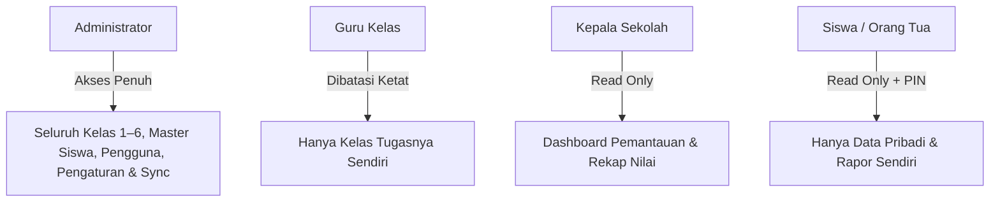

# DOKUMEN KEAMANAN SISTEM & PERLINDUNGAN DATA (SECURITY.md)
## SISTEM INFORMASI ABSENSI DAN NILAI SISWA SD

Keamanan data akademik dan privasi identitas siswa sekolah dasar merupakan prioritas utama dalam rancang bangun sistem ini.

---

## 1. Prinsip Utama Keamanan

1. **Prinsip Hak Akses Terkecil (*Principle of Least Privilege*)**:
   Pengguna hanya diberi hak akses minimal yang mutlak diperlukan untuk menyelesaikan tugasnya.
2. **Isolasi Rombongan Belajar Guru (*Teacher Class Boundaries*)**:
   Guru Kelas 1 tidak memiliki hak teknis maupun visual untuk mengubah atau menghapus data siswa, absensi, maupun nilai kelas lain.
3. **Privasi Portal Siswa (*Student Data Confidentiality*)**:
   Siswa dan orang tua hanya dapat melihat nilai dan absensi milik diri sendiri melalui PIN keamanan terverifikasi. Tidak ada celah bagi siswa untuk melihat data rekan sekelasnya.
4. **Pencegahan Penyimpanan Kredensial di Kode Sumber**:
   Kata sandi tidak pernah disimpan di Google Sheets maupun di file frontend JavaScript. Kredensial rahasia backend disimpan secara aman di Script Properties.

---

## 2. Model Otorisasi Multi-Peran (RBAC)

---

## 3. Aturan Keamanan Cloud Firestore (Firestore Security Rules)

- **Tidak Ada Aturan Publik Terbuka**: Aturan `allow read, write: if true;` **DILARANG KERAS**.
- Aturan validasi dijalankan langsung di server Firebase sebelum dokumen dibaca atau ditulis.
- Guru divalidasi memiliki atribut kelas pada `assignedClasses` sebelum diizinkan membuat atau memperbarui catatan di koleksi `attendance` atau `grades`.
- Audit log bersifat *Append-Only* (dokumen dapat dibuat tetapi tidak dapat diubah atau dihapus oleh siapapun demi integritas bukti audit).

---

## 4. Keamanan Integrasi Google Apps Script

1. **Validasi Request ID Token**:
   Setiap permintaan dari browser diverifikasi keabsahannya sebelum diproses oleh Apps Script.
2. **LockService Penulisan Konkuren**:
   Untuk mencegah kondisi balapan (*race condition*) saat beberapa guru menyimpan absensi pada waktu yang bersamaan, seluruh proses penulisan ke Google Sheets dilindungi oleh `LockService.getScriptLock()`.
3. **Sanitasi Masukan**:
   Seluruh nilai numerik (skor 0–100) dan tanggal divalidasi oleh `ValidationService.gs` sebelum ditulis ke dalam spreadsheet.
4. **Proteksi Folder Google Drive**:
   Folder arsip tidak berstatus publik. Hanya file foto profil spesifik yang memiliki tautan baca avatar, sementara dokumen rapor tetap terlindungi di dalam ekosistem sekolah.

---

## 5. Audit Trail & Log Aktivitas Pengguna

Setiap tindakan penting dalam sistem dicatat secara otomatis ke dalam sheet `Log_Aktivitas` dan koleksi Firestore `auditLogs`:
- Waktu kejadian (ISO-8601 WIB)
- User ID dan Nama Pengguna
- Jenis Tindakan (`TAMBAH_SISWA`, `UPDATE_SISWA`, `MUTASI_SISWA`, `INPUT_ABSENSI`, `INPUT_NILAI`, `UPLOAD_FOTO`, `SIMPAN_USER`)
- Entitas dan ID data terkait
- Rincian perubahan

Log ini menjamin akuntabilitas jika terjadi perubahan data nilai atau mutasi status siswa.
